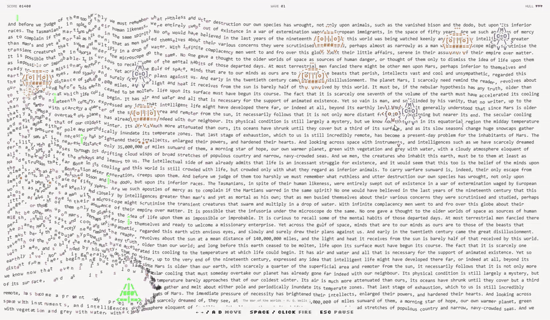
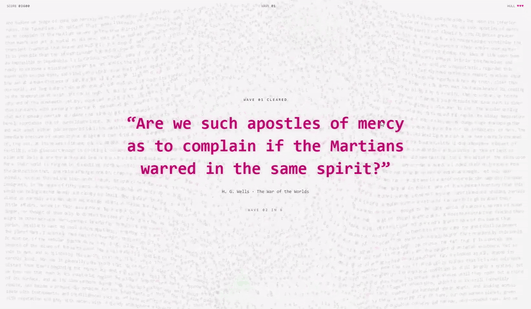

  <a href="../../README.md">English</a> · <a href="README.sv.md">Svenska</a> · <a href="README.de.md">Deutsch</a> · <strong>Español</strong> · <a href="README.fr.md">Français</a> · <a href="README.pt-BR.md">Português (Brasil)</a> · <a href="README.zh-CN.md">简体中文</a> · <a href="README.ja.md">日本語</a>

  

<strong>¿Qué pasa cuando combinas Space Invaders, literatura clásica y ASCII?</strong>

<a href="https://txtinvaders.com/"><strong>Juega en txtinvaders.com ↗</strong></a>

  
  
  
  
  

<code>npm install &amp;&amp; npm run dev:full</code>

  

  <strong>Supera la oleada. Descubre las palabras.</strong> 
  Cada oleada superada te recompensa con una cita del clásico que se esconde bajo el caos.

  

← → / A D para moverte · Espacio / clic para disparar · Esc para pausar · Pantalla táctil: mantén y arrastra

  Un juego de <a href="https://github.com/acatovic">Armin Catovic</a> · <a href="../../docs/DEVELOPMENT.md">Desarrollo</a> · <a href="../../docs/CREDITS.md">Créditos y licencias</a>

